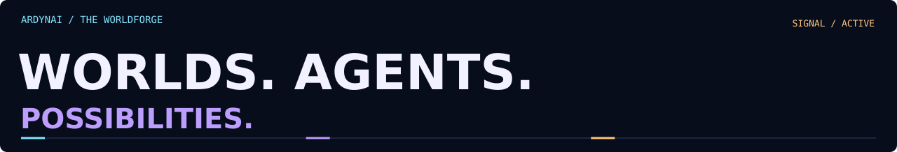
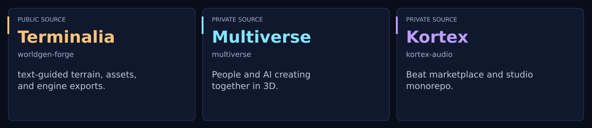
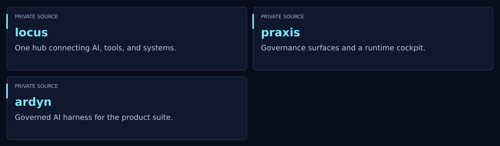
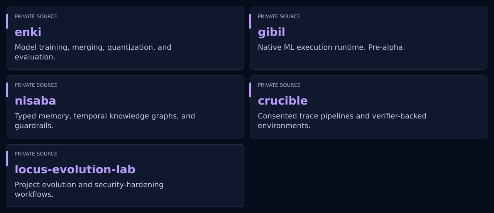
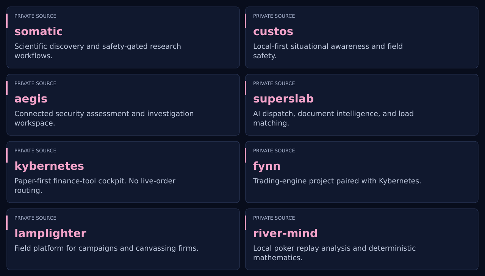
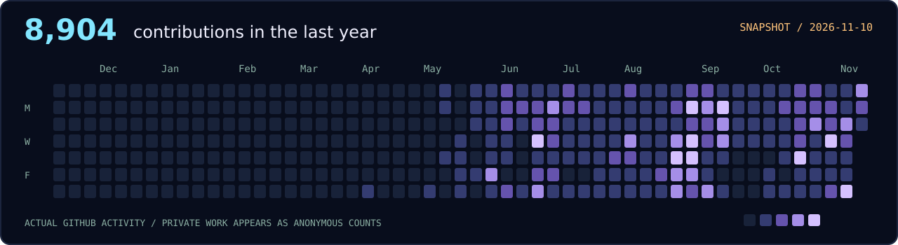

[View static edition / stop motion](README-static.md)

<picture><source media="(prefers-reduced-motion: reduce)" srcset="assets/orbital-worldforge.png"></picture>

<picture><source media="(max-width:680px)" srcset="assets/title-mobile.svg"></picture>

## Featured work

19 selected projects.

<picture><source media="(max-width:680px)" srcset="assets/lead-projects-mobile.svg"></picture>

- **[worldgen-forge](https://github.com/Ardynai/worldgen-forge)**: Terminalia: text-guided terrain, assets, and engine exports.
- **multiverse**: People and AI creating together in 3D.
- **kortex-audio**: Beat marketplace and studio monorepo.

<picture><source media="(prefers-reduced-motion: reduce)" srcset="assets/planetary-fabricator.png"></picture>

### AI operations

<picture><source media="(max-width:680px)" srcset="assets/sector-01-mobile.svg"></picture>

Read project summaries

- **locus**: One hub connecting AI, tools, and systems.
- **praxis**: Governance surfaces and a runtime cockpit.
- **ardyn**: Governed AI harness for the product suite.

<picture><source media="(prefers-reduced-motion: reduce)" srcset="assets/intelligence-vault.png"></picture>

### Models and memory

<picture><source media="(max-width:680px)" srcset="assets/sector-02-mobile.svg"></picture>

Read project summaries

- **enki**: Model training, merging, quantization, and evaluation.
- **gibil**: Native ML execution runtime. Pre-alpha.
- **nisaba**: Typed memory, temporal knowledge graphs, and guardrails.
- **crucible**: Consented trace pipelines and verifier-backed environments.
- **locus-evolution-lab**: Project evolution and security-hardening workflows.

### Applied systems

<picture><source media="(max-width:680px)" srcset="assets/sector-03-mobile.svg"></picture>

Read project summaries

- **somatic**: Scientific discovery and safety-gated research workflows.
- **custos**: Local-first situational awareness and field safety.
- **aegis**: Connected security assessment and investigation workspace.
- **superslab**: AI dispatch, document intelligence, and load matching.
- **kybernetes**: Paper-first finance-tool cockpit. No live-order routing.
- **fynn**: Trading-engine project paired with Kybernetes.
- **lamplighter**: Field platform for campaigns and canvassing firms.
- **river-mind**: Local poker replay analysis and deterministic mathematics.

## Public projects

<!-- PUBLIC-PROJECTS:START -->
### Public projects (1)

- [worldgen&#45;forge](https://github.com/Ardynai/worldgen-forge) · Agentic 3D open&#45;world generation at scale &#8212; terrain&#44; layout&#44; TRELLIS&#46;2 assets&#44; engine exports&#46; Any GPU or none&#46;
<!-- PUBLIC-PROJECTS:END -->

## Open-source forks

<!-- PUBLIC-FORKS:START -->
[**1,026 public forks**](https://github.com/Ardynai?tab=repositories&type=fork) · Explore my forked repositories.
<!-- PUBLIC-FORKS:END -->

Browse the complete public fork directory

0–9 &amp; symbols · 6

- [100-exercises-to-learn-rust](https://github.com/Ardynai/100-exercises-to-learn-rust)
- [10x](https://github.com/Ardynai/10x)
- [3d-model-anything](https://github.com/Ardynai/3d-model-anything)
- [3dgs-render-blender-addon](https://github.com/Ardynai/3dgs-render-blender-addon)
- [3x-ui](https://github.com/Ardynai/3x-ui)
- [9router](https://github.com/Ardynai/9router)

A · 115

- [a-evolve](https://github.com/Ardynai/a-evolve)
- [A2A](https://github.com/Ardynai/A2A)
- [ableton-mcp](https://github.com/Ardynai/ableton-mcp)
- [abliterator](https://github.com/Ardynai/abliterator)
- [abot-world](https://github.com/Ardynai/abot-world)
- [ACE-Step](https://github.com/Ardynai/ACE-Step)
- [ACE-Step-1.5](https://github.com/Ardynai/ACE-Step-1.5)
- [ace-step-ui](https://github.com/Ardynai/ace-step-ui)
- [acpx](https://github.com/Ardynai/acpx)
- [activepieces](https://github.com/Ardynai/activepieces)
- [activitypub](https://github.com/Ardynai/activitypub)
- [AdaptixC2](https://github.com/Ardynai/AdaptixC2)
- [adk-go](https://github.com/Ardynai/adk-go)
- [adk-python](https://github.com/Ardynai/adk-python)
- [AFFiNE](https://github.com/Ardynai/AFFiNE)
- [aframe](https://github.com/Ardynai/aframe)
- [agency-agents](https://github.com/Ardynai/agency-agents)
- [agent-browser](https://github.com/Ardynai/agent-browser)
- [agent-desktop](https://github.com/Ardynai/agent-desktop)
- [agent-identity-management](https://github.com/Ardynai/agent-identity-management)
- [Agent-Reach](https://github.com/Ardynai/Agent-Reach)
- [agent-scan](https://github.com/Ardynai/agent-scan)
- [agent-skills](https://github.com/Ardynai/agent-skills)
- [agent-skills-for-context-engineering](https://github.com/Ardynai/agent-skills-for-context-engineering)
- [agent-zero](https://github.com/Ardynai/agent-zero)
- [agentconnect](https://github.com/Ardynai/agentconnect)
- [agentic-inbox](https://github.com/Ardynai/agentic-inbox)
- [agentmemory](https://github.com/Ardynai/agentmemory)
- [AgentNetworkProtocol](https://github.com/Ardynai/AgentNetworkProtocol)
- [agents](https://github.com/Ardynai/agents)
- [agents-a1](https://github.com/Ardynai/agents-a1)
- [agentscope](https://github.com/Ardynai/agentscope)
- [agentscope-bricks](https://github.com/Ardynai/agentscope-bricks)
- [agentscope-java](https://github.com/Ardynai/agentscope-java)
- [agentscope-runtime](https://github.com/Ardynai/agentscope-runtime)
- [agentscopeskills](https://github.com/Ardynai/agentscopeskills)
- [agentskills](https://github.com/Ardynai/agentskills)
- [agentviz](https://github.com/Ardynai/agentviz)
- [agnai](https://github.com/Ardynai/agnai)
- [aholo-viewer](https://github.com/Ardynai/aholo-viewer)
- [ai-hedge-fund](https://github.com/Ardynai/ai-hedge-fund)
- [ai-model-distillation-for-financial-data](https://github.com/Ardynai/ai-model-distillation-for-financial-data)
- [AI-Scientist](https://github.com/Ardynai/AI-Scientist)
- [AI-Scientist-v2](https://github.com/Ardynai/AI-Scientist-v2)
- [ai-toolkit](https://github.com/Ardynai/ai-toolkit)
- [ai-town](https://github.com/Ardynai/ai-town)
- [AI-Trader](https://github.com/Ardynai/AI-Trader)
- [AI2PentestTool](https://github.com/Ardynai/AI2PentestTool)
- [aider](https://github.com/Ardynai/aider)
- [aiortc](https://github.com/Ardynai/aiortc)
- [AirSim](https://github.com/Ardynai/AirSim)
- [aislop](https://github.com/Ardynai/aislop)
- [aitoearn](https://github.com/Ardynai/aitoearn)
- [aitoolkit](https://github.com/Ardynai/aitoolkit)
- [AlayaWorld](https://github.com/Ardynai/AlayaWorld)
- [alchemist](https://github.com/Ardynai/alchemist)
- [alpaca-mcp-server](https://github.com/Ardynai/alpaca-mcp-server)
- [alpaca-py](https://github.com/Ardynai/alpaca-py)
- [alpha_vantage](https://github.com/Ardynai/alpha_vantage)
- [alphaclaw](https://github.com/Ardynai/alphaclaw)
- [amuseai](https://github.com/Ardynai/amuseai)
- [analytics](https://github.com/Ardynai/analytics)
- [andrej-karpathy-skills](https://github.com/Ardynai/andrej-karpathy-skills)
- [annas-archive](https://github.com/Ardynai/annas-archive)
- [Anthropic-Cybersecurity-Skills](https://github.com/Ardynai/Anthropic-Cybersecurity-Skills)
- [anymove](https://github.com/Ardynai/anymove)
- [AnyRecon](https://github.com/Ardynai/AnyRecon)
- [anything2explainer](https://github.com/Ardynai/anything2explainer)
- [anytype-ts](https://github.com/Ardynai/anytype-ts)
- [apify-cli](https://github.com/Ardynai/apify-cli)
- [apify-mcp-server](https://github.com/Ardynai/apify-mcp-server)
- [AppFlowy](https://github.com/Ardynai/AppFlowy)
- [apple-configurator-sample](https://github.com/Ardynai/apple-configurator-sample)
- [appsmith](https://github.com/Ardynai/appsmith)
- [arbor](https://github.com/Ardynai/arbor)
- [ardy](https://github.com/Ardynai/ardy)
- [arnis](https://github.com/Ardynai/arnis)
- [artcraft](https://github.com/Ardynai/artcraft)
- [artcraft-services](https://github.com/Ardynai/artcraft-services)
- [articraft](https://github.com/Ardynai/articraft)
- [ASCILINE](https://github.com/Ardynai/ASCILINE)
- [ASI-Evolve](https://github.com/Ardynai/ASI-Evolve)
- [asnmap](https://github.com/Ardynai/asnmap)
- [asterisk](https://github.com/Ardynai/asterisk)
- [astryx](https://github.com/Ardynai/astryx)
- [atlas-gic](https://github.com/Ardynai/atlas-gic)
- [atomic-operator](https://github.com/Ardynai/atomic-operator)
- [atproto](https://github.com/Ardynai/atproto)
- [Audio2Face-3D](https://github.com/Ardynai/Audio2Face-3D)
- [Audio2Face-3D-SDK](https://github.com/Ardynai/Audio2Face-3D-SDK)
- [audiocraft](https://github.com/Ardynai/audiocraft)
- [auto-browser](https://github.com/Ardynai/auto-browser)
- [autogen](https://github.com/Ardynai/autogen)
- [Autonomix](https://github.com/Ardynai/Autonomix)
- [autopsy](https://github.com/Ardynai/autopsy)
- [autoscientists](https://github.com/Ardynai/autoscientists)
- [avtr-1](https://github.com/Ardynai/avtr-1)
- [awesome](https://github.com/Ardynai/awesome)
- [awesome-3d-gaussian-splatting](https://github.com/Ardynai/awesome-3d-gaussian-splatting)
- [awesome-ai-apps](https://github.com/Ardynai/awesome-ai-apps)
- [awesome-ai-music-generation](https://github.com/Ardynai/awesome-ai-music-generation)
- [awesome-compose](https://github.com/Ardynai/awesome-compose)
- [awesome-gamedev-agent-skills](https://github.com/Ardynai/awesome-gamedev-agent-skills)
- [awesome-gaussians](https://github.com/Ardynai/awesome-gaussians)
- [awesome-harness-engineering](https://github.com/Ardynai/awesome-harness-engineering)
- [awesome-llm-apps](https://github.com/Ardynai/awesome-llm-apps)
- [awesome-nutrient](https://github.com/Ardynai/awesome-nutrient)
- [Awesome-RealityKit](https://github.com/Ardynai/Awesome-RealityKit)
- [awesome-rtc](https://github.com/Ardynai/awesome-rtc)
- [awesome-selfhosted](https://github.com/Ardynai/awesome-selfhosted)
- [awesome-systematic-trading](https://github.com/Ardynai/awesome-systematic-trading)
- [awesome-tunneling](https://github.com/Ardynai/awesome-tunneling)
- [awesome-visionOS](https://github.com/Ardynai/awesome-visionOS)
- [awesome-wifi-csi-sensing](https://github.com/Ardynai/awesome-wifi-csi-sensing)
- [awesome-wooting](https://github.com/Ardynai/awesome-wooting)

B · 29

- [Babylon.js](https://github.com/Ardynai/Babylon.js)
- [bark](https://github.com/Ardynai/bark)
- [bbot](https://github.com/Ardynai/bbot)
- [beautify-github-profile](https://github.com/Ardynai/beautify-github-profile)
- [bevy](https://github.com/Ardynai/bevy)
- [BigBang-v1](https://github.com/Ardynai/BigBang-v1)
- [binwalk](https://github.com/Ardynai/binwalk)
- [birdclaw](https://github.com/Ardynai/birdclaw)
- [bla](https://github.com/Ardynai/bla)
- [blender](https://github.com/Ardynai/blender)
- [blender-skills](https://github.com/Ardynai/blender-skills)
- [BlenderTools](https://github.com/Ardynai/BlenderTools)
- [bloodhound](https://github.com/Ardynai/bloodhound)
- [bloomberg-terminal-free](https://github.com/Ardynai/bloomberg-terminal-free)
- [boogu-image](https://github.com/Ardynai/boogu-image)
- [brain2qwerty](https://github.com/Ardynai/brain2qwerty)
- [brax](https://github.com/Ardynai/brax)
- [brigade](https://github.com/Ardynai/brigade)
- [build-your-own-bittorrent](https://github.com/Ardynai/build-your-own-bittorrent)
- [build-your-own-git](https://github.com/Ardynai/build-your-own-git)
- [build-your-own-redis](https://github.com/Ardynai/build-your-own-redis)
- [build-your-own-shell](https://github.com/Ardynai/build-your-own-shell)
- [build-your-own-sqlite](https://github.com/Ardynai/build-your-own-sqlite)
- [build-your-own-x](https://github.com/Ardynai/build-your-own-x)
- [builder-relayer-client](https://github.com/Ardynai/builder-relayer-client)
- [buildx](https://github.com/Ardynai/buildx)
- [bumblebee](https://github.com/Ardynai/bumblebee)
- [burpgpt](https://github.com/Ardynai/burpgpt)
- [buzz](https://github.com/Ardynai/buzz)

C · 90

- [caclawphony](https://github.com/Ardynai/caclawphony)
- [cadam](https://github.com/Ardynai/cadam)
- [cadcraft](https://github.com/Ardynai/cadcraft)
- [cal.com](https://github.com/Ardynai/cal.com)
- [camofox-browser](https://github.com/Ardynai/camofox-browser)
- [capacitor](https://github.com/Ardynai/capacitor)
- [carbonyl](https://github.com/Ardynai/carbonyl)
- [caveman](https://github.com/Ardynai/caveman)
- [cc_blender_tools](https://github.com/Ardynai/cc_blender_tools)
- [ccxt](https://github.com/Ardynai/ccxt)
- [Centipede](https://github.com/Ardynai/Centipede)
- [centrifugo](https://github.com/Ardynai/centrifugo)
- [cesium](https://github.com/Ardynai/cesium)
- [cewl](https://github.com/Ardynai/cewl)
- [chalk](https://github.com/Ardynai/chalk)
- [chisel](https://github.com/Ardynai/chisel)
- [chrome-devtools-mcp](https://github.com/Ardynai/chrome-devtools-mcp)
- [cirro](https://github.com/Ardynai/cirro)
- [CL4R1T4S](https://github.com/Ardynai/CL4R1T4S)
- [claude-ads](https://github.com/Ardynai/claude-ads)
- [claude-agent-sdk-python](https://github.com/Ardynai/claude-agent-sdk-python)
- [claude-code](https://github.com/Ardynai/claude-code)
- [claude-code-best-practice](https://github.com/Ardynai/claude-code-best-practice)
- [claude-cookbooks](https://github.com/Ardynai/claude-cookbooks)
- [claude-howto](https://github.com/Ardynai/claude-howto)
- [claude-seo](https://github.com/Ardynai/claude-seo)
- [Claw3D](https://github.com/Ardynai/Claw3D)
- [clawhub](https://github.com/Ardynai/clawhub)
- [clawk](https://github.com/Ardynai/clawk)
- [clawsweeper](https://github.com/Ardynai/clawsweeper)
- [cli](https://github.com/Ardynai/cli)
- [CLI-Anything](https://github.com/Ardynai/CLI-Anything)
- [client-python](https://github.com/Ardynai/client-python)
- [cline](https://github.com/Ardynai/cline)
- [ClinFusion](https://github.com/Ardynai/ClinFusion)
- [cloakbrowser](https://github.com/Ardynai/cloakbrowser)
- [cloudcompare](https://github.com/Ardynai/cloudcompare)
- [cloudflare-os](https://github.com/Ardynai/cloudflare-os)
- [cloudfox](https://github.com/Ardynai/cloudfox)
- [Clouds-Against-Humanity](https://github.com/Ardynai/Clouds-Against-Humanity)
- [codebase-memory-mcp](https://github.com/Ardynai/codebase-memory-mcp)
- [codeflow](https://github.com/Ardynai/codeflow)
- [codegraph](https://github.com/Ardynai/codegraph)
- [codex](https://github.com/Ardynai/codex)
- [codex-plugin-cc](https://github.com/Ardynai/codex-plugin-cc)
- [codex-security](https://github.com/Ardynai/codex-security)
- [codex-seo](https://github.com/Ardynai/codex-seo)
- [coding-interview-university](https://github.com/Ardynai/coding-interview-university)
- [Codync](https://github.com/Ardynai/Codync)
- [cognee](https://github.com/Ardynai/cognee)
- [colmap](https://github.com/Ardynai/colmap)
- [comfy-openjutsu](https://github.com/Ardynai/comfy-openjutsu)
- [ComfyUI](https://github.com/Ardynai/ComfyUI)
- [comfyui-conditioningkrea2rebalance](https://github.com/Ardynai/comfyui-conditioningkrea2rebalance)
- [comfyui-sage-easyinstall](https://github.com/Ardynai/comfyui-sage-easyinstall)
- [ComfyUI-SegviGen](https://github.com/Ardynai/ComfyUI-SegviGen)
- [comfyui-tripo](https://github.com/Ardynai/comfyui-tripo)
- [ComfyUI_frontend](https://github.com/Ardynai/ComfyUI_frontend)
- [commander.js](https://github.com/Ardynai/commander.js)
- [compose](https://github.com/Ardynai/compose)
- [composio](https://github.com/Ardynai/composio)
- [compound-engineering-plugin](https://github.com/Ardynai/compound-engineering-plugin)
- [congress](https://github.com/Ardynai/congress)
- [connect-es](https://github.com/Ardynai/connect-es)
- [connect-samples](https://github.com/Ardynai/connect-samples)
- [containerd](https://github.com/Ardynai/containerd)
- [content-agents](https://github.com/Ardynai/content-agents)
- [content-localization](https://github.com/Ardynai/content-localization)
- [context-mode](https://github.com/Ardynai/context-mode)
- [continue](https://github.com/Ardynai/continue)
- [continuous-thought-machines](https://github.com/Ardynai/continuous-thought-machines)
- [coolify](https://github.com/Ardynai/coolify)
- [coop-anything](https://github.com/Ardynai/coop-anything)
- [CorridorKey](https://github.com/Ardynai/CorridorKey)
- [coscientist](https://github.com/Ardynai/coscientist)
- [coss](https://github.com/Ardynai/coss)
- [CosyVoice](https://github.com/Ardynai/CosyVoice)
- [coturn](https://github.com/Ardynai/coturn)
- [courses](https://github.com/Ardynai/courses)
- [crabbox](https://github.com/Ardynai/crabbox)
- [crawl4ai](https://github.com/Ardynai/crawl4ai)
- [crawlee](https://github.com/Ardynai/crawlee)
- [crawlee-python](https://github.com/Ardynai/crawlee-python)
- [crewAI](https://github.com/Ardynai/crewAI)
- [crowdsec](https://github.com/Ardynai/crowdsec)
- [crucix](https://github.com/Ardynai/crucix)
- [cube](https://github.com/Ardynai/cube)
- [CubeSandbox](https://github.com/Ardynai/CubeSandbox)
- [cuFOLIO](https://github.com/Ardynai/cuFOLIO)
- [cupy](https://github.com/Ardynai/cupy)

D · 53

- [daily_stock_analysis](https://github.com/Ardynai/daily_stock_analysis)
- [danceopd](https://github.com/Ardynai/danceopd)
- [datawave](https://github.com/Ardynai/datawave)
- [dax](https://github.com/Ardynai/dax)
- [deccp](https://github.com/Ardynai/deccp)
- [Decepticon](https://github.com/Ardynai/Decepticon)
- [deckcraft](https://github.com/Ardynai/deckcraft)
- [Deep-Live-Cam](https://github.com/Ardynai/Deep-Live-Cam)
- [deep-swe](https://github.com/Ardynai/deep-swe)
- [deepagents](https://github.com/Ardynai/deepagents)
- [DeepCode](https://github.com/Ardynai/DeepCode)
- [DeepFaceLive](https://github.com/Ardynai/DeepFaceLive)
- [DeepInfer](https://github.com/Ardynai/DeepInfer)
- [DeepixLab](https://github.com/Ardynai/DeepixLab)
- [deepseek-harness](https://github.com/Ardynai/deepseek-harness)
- [deepspec](https://github.com/Ardynai/deepspec)
- [deepteam](https://github.com/Ardynai/deepteam)
- [DeepTutor](https://github.com/Ardynai/DeepTutor)
- [deepwiki-open](https://github.com/Ardynai/deepwiki-open)
- [deer-flow](https://github.com/Ardynai/deer-flow)
- [demucs](https://github.com/Ardynai/demucs)
- [design.md](https://github.com/Ardynai/design.md)
- [devbox](https://github.com/Ardynai/devbox)
- [developer-portfolios](https://github.com/Ardynai/developer-portfolios)
- [dexter](https://github.com/Ardynai/dexter)
- [did-core](https://github.com/Ardynai/did-core)
- [did-jwt](https://github.com/Ardynai/did-jwt)
- [diff4splat](https://github.com/Ardynai/diff4splat)
- [diffrhythm](https://github.com/Ardynai/diffrhythm)
- [DiffusionOPSD](https://github.com/Ardynai/DiffusionOPSD)
- [Diffusionstudio-editor](https://github.com/Ardynai/Diffusionstudio-editor)
- [dify](https://github.com/Ardynai/dify)
- [dioxus](https://github.com/Ardynai/dioxus)
- [directus](https://github.com/Ardynai/directus)
- [DistillKit](https://github.com/Ardynai/DistillKit)
- [dockercli](https://github.com/Ardynai/dockercli)
- [docusaurus](https://github.com/Ardynai/docusaurus)
- [docuseal](https://github.com/Ardynai/docuseal)
- [DojoZero](https://github.com/Ardynai/DojoZero)
- [domainshuttle](https://github.com/Ardynai/domainshuttle)
- [dots.tts](https://github.com/Ardynai/dots.tts)
- [draggable](https://github.com/Ardynai/draggable)
- [drawio-skill](https://github.com/Ardynai/drawio-skill)
- [dream-loop](https://github.com/Ardynai/dream-loop)
- [dreamx-world](https://github.com/Ardynai/dreamx-world)
- [drei](https://github.com/Ardynai/drei)
- [driftnet](https://github.com/Ardynai/driftnet)
- [drizzle-orm](https://github.com/Ardynai/drizzle-orm)
- [dsh-superagent-prototype](https://github.com/Ardynai/dsh-superagent-prototype)
- [dspy](https://github.com/Ardynai/dspy)
- [dub](https://github.com/Ardynai/dub)
- [Duix-Avatar](https://github.com/Ardynai/Duix-Avatar)
- [dvlt](https://github.com/Ardynai/dvlt)

E · 15

- [ECC](https://github.com/Ardynai/ECC)
- [edgs](https://github.com/Ardynai/edgs)
- [editor](https://github.com/Ardynai/editor)
- [effectcraft](https://github.com/Ardynai/effectcraft)
- [engine](https://github.com/Ardynai/engine)
- [ErisForge](https://github.com/Ardynai/ErisForge)
- [erpnext](https://github.com/Ardynai/erpnext)
- [esp32-wifi-sensing](https://github.com/Ardynai/esp32-wifi-sensing)
- [evals](https://github.com/Ardynai/evals)
- [evolutionary-model-merge](https://github.com/Ardynai/evolutionary-model-merge)
- [evolver](https://github.com/Ardynai/evolver)
- [excalidraw](https://github.com/Ardynai/excalidraw)
- [excel-mcp-server](https://github.com/Ardynai/excel-mcp-server)
- [expo](https://github.com/Ardynai/expo)
- [external-agents](https://github.com/Ardynai/external-agents)

F · 36

- [fable-method](https://github.com/Ardynai/fable-method)
- [fallow](https://github.com/Ardynai/fallow)
- [FashionChameleon](https://github.com/Ardynai/FashionChameleon)
- [FastChat](https://github.com/Ardynai/FastChat)
- [faster-gaussian-splatting](https://github.com/Ardynai/faster-gaussian-splatting)
- [FastGPT](https://github.com/Ardynai/FastGPT)
- [fastmcp](https://github.com/Ardynai/fastmcp)
- [ff-tracking](https://github.com/Ardynai/ff-tracking)
- [fff](https://github.com/Ardynai/fff)
- [ffmpeg](https://github.com/Ardynai/ffmpeg)
- [ffmpeg-skill](https://github.com/Ardynai/ffmpeg-skill)
- [ffuf](https://github.com/Ardynai/ffuf)
- [figcraft](https://github.com/Ardynai/figcraft)
- [filmcraft](https://github.com/Ardynai/filmcraft)
- [financial-services](https://github.com/Ardynai/financial-services)
- [FinceptTerminal](https://github.com/Ardynai/FinceptTerminal)
- [finnhub-python](https://github.com/Ardynai/finnhub-python)
- [fish-speech](https://github.com/Ardynai/fish-speech)
- [Flawless](https://github.com/Ardynai/Flawless)
- [fli](https://github.com/Ardynai/fli)
- [floci](https://github.com/Ardynai/floci)
- [Flowise](https://github.com/Ardynai/Flowise)
- [flowsint](https://github.com/Ardynai/flowsint)
- [flue](https://github.com/Ardynai/flue)
- [FluidVoice](https://github.com/Ardynai/FluidVoice)
- [flutter](https://github.com/Ardynai/flutter)
- [fluxion](https://github.com/Ardynai/fluxion)
- [fluxrt](https://github.com/Ardynai/fluxrt)
- [Fooocus](https://github.com/Ardynai/Fooocus)
- [fortress](https://github.com/Ardynai/fortress)
- [free-for-dev](https://github.com/Ardynai/free-for-dev)
- [FreeDomain](https://github.com/Ardynai/FreeDomain)
- [freqtrade](https://github.com/Ardynai/freqtrade)
- [frigate](https://github.com/Ardynai/frigate)
- [fugu](https://github.com/Ardynai/fugu)
- [fzf](https://github.com/Ardynai/fzf)

G · 45

- [garak](https://github.com/Ardynai/garak)
- [gaussian-splatting](https://github.com/Ardynai/gaussian-splatting)
- [gaussiansplats3d](https://github.com/Ardynai/gaussiansplats3d)
- [GaussianTalker](https://github.com/Ardynai/GaussianTalker)
- [gbrain](https://github.com/Ardynai/gbrain)
- [GDevelop](https://github.com/Ardynai/GDevelop)
- [gef](https://github.com/Ardynai/gef)
- [gemini-cli](https://github.com/Ardynai/gemini-cli)
- [genai-stack](https://github.com/Ardynai/genai-stack)
- [gencad](https://github.com/Ardynai/gencad)
- [gensim](https://github.com/Ardynai/gensim)
- [ghidra](https://github.com/Ardynai/ghidra)
- [ghost](https://github.com/Ardynai/ghost)
- [Ghost-Downloader-3](https://github.com/Ardynai/Ghost-Downloader-3)
- [ghunt](https://github.com/Ardynai/ghunt)
- [gibber-mcp](https://github.com/Ardynai/gibber-mcp)
- [gigatoken](https://github.com/Ardynai/gigatoken)
- [githubcli](https://github.com/Ardynai/githubcli)
- [GitNexus](https://github.com/Ardynai/GitNexus)
- [glint](https://github.com/Ardynai/glint)
- [glossopetrae](https://github.com/Ardynai/glossopetrae)
- [glove](https://github.com/Ardynai/glove)
- [GNM](https://github.com/Ardynai/GNM)
- [gobuster](https://github.com/Ardynai/gobuster)
- [godot](https://github.com/Ardynai/godot)
- [GolaemForUnreal](https://github.com/Ardynai/GolaemForUnreal)
- [googleworkspacecli](https://github.com/Ardynai/googleworkspacecli)
- [goose](https://github.com/Ardynai/goose)
- [gorest-2d-animation-spritesheet-generator](https://github.com/Ardynai/gorest-2d-animation-spritesheet-generator)
- [gpu-unlock-ada](https://github.com/Ardynai/gpu-unlock-ada)
- [GR00T-WholeBodyControl](https://github.com/Ardynai/GR00T-WholeBodyControl)
- [grafana](https://github.com/Ardynai/grafana)
- [graphify](https://github.com/Ardynai/graphify)
- [gridcraft](https://github.com/Ardynai/gridcraft)
- [grok-1](https://github.com/Ardynai/grok-1)
- [grok-bot-0.18-reconstructed](https://github.com/Ardynai/grok-bot-0.18-reconstructed)
- [grok-build](https://github.com/Ardynai/grok-build)
- [grpc](https://github.com/Ardynai/grpc)
- [grpc-node](https://github.com/Ardynai/grpc-node)
- [grpc-web](https://github.com/Ardynai/grpc-web)
- [gsap-skills](https://github.com/Ardynai/gsap-skills)
- [gsplat-unity](https://github.com/Ardynai/gsplat-unity)
- [gstack](https://github.com/Ardynai/gstack)
- [GTweak](https://github.com/Ardynai/GTweak)
- [gymnax](https://github.com/Ardynai/gymnax)

H · 28

- [hackingtool](https://github.com/Ardynai/hackingtool)
- [hallmark](https://github.com/Ardynai/hallmark)
- [halo](https://github.com/Ardynai/halo)
- [Handy](https://github.com/Ardynai/Handy)
- [harness2](https://github.com/Ardynai/harness2)
- [havoc](https://github.com/Ardynai/havoc)
- [heretic](https://github.com/Ardynai/heretic)
- [hermes-agent](https://github.com/Ardynai/hermes-agent)
- [hermes-desktop](https://github.com/Ardynai/hermes-desktop)
- [hexstrike-ai](https://github.com/Ardynai/hexstrike-ai)
- [hi3dv1.0](https://github.com/Ardynai/hi3dv1.0)
- [HiClaw](https://github.com/Ardynai/HiClaw)
- [hig](https://github.com/Ardynai/hig)
- [hindsight](https://github.com/Ardynai/hindsight)
- [holehe](https://github.com/Ardynai/holehe)
- [homie](https://github.com/Ardynai/homie)
- [hoppscotch](https://github.com/Ardynai/hoppscotch)
- [HTTPiecli](https://github.com/Ardynai/HTTPiecli)
- [httpsms](https://github.com/Ardynai/httpsms)
- [hunyuan-gamecraft-1.0](https://github.com/Ardynai/hunyuan-gamecraft-1.0)
- [Hunyuan3D-WorldClaw](https://github.com/Ardynai/Hunyuan3D-WorldClaw)
- [HunyuanWorld-1.0](https://github.com/Ardynai/HunyuanWorld-1.0)
- [hy-world-2.0](https://github.com/Ardynai/hy-world-2.0)
- [Hy3](https://github.com/Ardynai/Hy3)
- [hydra](https://github.com/Ardynai/hydra)
- [hydra-viewport-toolbox](https://github.com/Ardynai/hydra-viewport-toolbox)
- [hyper](https://github.com/Ardynai/hyper)
- [hyperframes](https://github.com/Ardynai/hyperframes)

I · 18

- [i1](https://github.com/Ardynai/i1)
- [iAgent](https://github.com/Ardynai/iAgent)
- [ID-LoRA-LTX2.3-ComfyUI](https://github.com/Ardynai/ID-LoRA-LTX2.3-ComfyUI)
- [identity-eraser](https://github.com/Ardynai/identity-eraser)
- [image-blaster](https://github.com/Ardynai/image-blaster)
- [img2threejs](https://github.com/Ardynai/img2threejs)
- [immich](https://github.com/Ardynai/immich)
- [impacket](https://github.com/Ardynai/impacket)
- [impeccable](https://github.com/Ardynai/impeccable)
- [improve](https://github.com/Ardynai/improve)
- [inbox-zero](https://github.com/Ardynai/inbox-zero)
- [infinite-bookshelf](https://github.com/Ardynai/infinite-bookshelf)
- [infinity](https://github.com/Ardynai/infinity)
- [ink-image](https://github.com/Ardynai/ink-image)
- [inochi2d](https://github.com/Ardynai/inochi2d)
- [Inquirer.js](https://github.com/Ardynai/Inquirer.js)
- [invoice-builder](https://github.com/Ardynai/invoice-builder)
- [ivre](https://github.com/Ardynai/ivre)

J · 13

- [janus-gateway](https://github.com/Ardynai/janus-gateway)
- [jcode](https://github.com/Ardynai/jcode)
- [jellyfin](https://github.com/Ardynai/jellyfin)
- [jitsi-meet](https://github.com/Ardynai/jitsi-meet)
- [JoltPhysics](https://github.com/Ardynai/JoltPhysics)
- [joro](https://github.com/Ardynai/joro)
- [JoyAI-Video-Edit](https://github.com/Ardynai/JoyAI-Video-Edit)
- [js-libp2p](https://github.com/Ardynai/js-libp2p)
- [js-three](https://github.com/Ardynai/js-three)
- [jules-action](https://github.com/Ardynai/jules-action)
- [jules-awesome-list](https://github.com/Ardynai/jules-awesome-list)
- [jules-sdk](https://github.com/Ardynai/jules-sdk)
- [jules-skills](https://github.com/Ardynai/jules-skills)

K · 11

- [kanban](https://github.com/Ardynai/kanban)
- [keycloak](https://github.com/Ardynai/keycloak)
- [kinopio-client](https://github.com/Ardynai/kinopio-client)
- [kit-app-template](https://github.com/Ardynai/kit-app-template)
- [kit-usd-agents](https://github.com/Ardynai/kit-usd-agents)
- [kmp-production-sample](https://github.com/Ardynai/kmp-production-sample)
- [knowledge-work-plugins](https://github.com/Ardynai/knowledge-work-plugins)
- [kotlin](https://github.com/Ardynai/kotlin)
- [krea-2](https://github.com/Ardynai/krea-2)
- [Kronos](https://github.com/Ardynai/Kronos)
- [kubo](https://github.com/Ardynai/kubo)

L · 42

- [L1B3RT4S](https://github.com/Ardynai/L1B3RT4S)
- [langchain](https://github.com/Ardynai/langchain)
- [langfuse](https://github.com/Ardynai/langfuse)
- [langgraph](https://github.com/Ardynai/langgraph)
- [last30days-skill](https://github.com/Ardynai/last30days-skill)
- [laya](https://github.com/Ardynai/laya)
- [LeapTalk](https://github.com/Ardynai/LeapTalk)
- [LearnOpenUSD](https://github.com/Ardynai/LearnOpenUSD)
- [lemo-opuscar](https://github.com/Ardynai/lemo-opuscar)
- [leptos](https://github.com/Ardynai/leptos)
- [lerobot](https://github.com/Ardynai/lerobot)
- [lingbot-map](https://github.com/Ardynai/lingbot-map)
- [lingbot-world](https://github.com/Ardynai/lingbot-world)
- [lingbot-world-v2](https://github.com/Ardynai/lingbot-world-v2)
- [listmonk](https://github.com/Ardynai/listmonk)
- [liteparse](https://github.com/Ardynai/liteparse)
- [LiteRT](https://github.com/Ardynai/LiteRT)
- [liveblocks](https://github.com/Ardynai/liveblocks)
- [liveedit](https://github.com/Ardynai/liveedit)
- [livekit](https://github.com/Ardynai/livekit)
- [llama.cpp](https://github.com/Ardynai/llama.cpp)
- [LlamaFactoryLORA](https://github.com/Ardynai/LlamaFactoryLORA)
- [llm-router](https://github.com/Ardynai/llm-router)
- [lm-evaluation-harness](https://github.com/Ardynai/lm-evaluation-harness)
- [lobster](https://github.com/Ardynai/lobster)
- [local-deep-researcher](https://github.com/Ardynai/local-deep-researcher)
- [localsend](https://github.com/Ardynai/localsend)
- [LOGOS](https://github.com/Ardynai/LOGOS)
- [logseq](https://github.com/Ardynai/logseq)
- [longcat-2.0](https://github.com/Ardynai/longcat-2.0)
- [longcat-video](https://github.com/Ardynai/longcat-video)
- [LongHorizon-Harness](https://github.com/Ardynai/LongHorizon-Harness)
- [longlive](https://github.com/Ardynai/longlive)
- [loop-engineering](https://github.com/Ardynai/loop-engineering)
- [loopx](https://github.com/Ardynai/loopx)
- [LoRA](https://github.com/Ardynai/LoRA)
- [lore](https://github.com/Ardynai/lore)
- [LTX-2](https://github.com/Ardynai/LTX-2)
- [lucia](https://github.com/Ardynai/lucia)
- [lucida](https://github.com/Ardynai/lucida)
- [LWM](https://github.com/Ardynai/LWM)
- [lyra](https://github.com/Ardynai/lyra)

M · 74

- [mage](https://github.com/Ardynai/mage)
- [magenta-realtime](https://github.com/Ardynai/magenta-realtime)
- [mamma](https://github.com/Ardynai/mamma)
- [manim](https://github.com/Ardynai/manim)
- [map-anything](https://github.com/Ardynai/map-anything)
- [map3d](https://github.com/Ardynai/map3d)
- [mapcn](https://github.com/Ardynai/mapcn)
- [marketingskills](https://github.com/Ardynai/marketingskills)
- [markitdown](https://github.com/Ardynai/markitdown)
- [marvin](https://github.com/Ardynai/marvin)
- [masscan](https://github.com/Ardynai/masscan)
- [massgen](https://github.com/Ardynai/massgen)
- [mastra](https://github.com/Ardynai/mastra)
- [Matrix-3D](https://github.com/Ardynai/Matrix-3D)
- [matrix-appservice-bridge](https://github.com/Ardynai/matrix-appservice-bridge)
- [matrix-game](https://github.com/Ardynai/matrix-game)
- [matrix-js-sdk](https://github.com/Ardynai/matrix-js-sdk)
- [matrix-spec](https://github.com/Ardynai/matrix-spec)
- [mattermost](https://github.com/Ardynai/mattermost)
- [mcp_massive](https://github.com/Ardynai/mcp_massive)
- [mediasoup](https://github.com/Ardynai/mediasoup)
- [medusa](https://github.com/Ardynai/medusa)
- [meetily](https://github.com/Ardynai/meetily)
- [mem0](https://github.com/Ardynai/mem0)
- [memoriki](https://github.com/Ardynai/memoriki)
- [MemVerse](https://github.com/Ardynai/MemVerse)
- [memvid](https://github.com/Ardynai/memvid)
- [mergekit](https://github.com/Ardynai/mergekit)
- [mermaid](https://github.com/Ardynai/mermaid)
- [mermaid-cli](https://github.com/Ardynai/mermaid-cli)
- [mermaid-live-editor](https://github.com/Ardynai/mermaid-live-editor)
- [mesh2motion-desktop](https://github.com/Ardynai/mesh2motion-desktop)
- [meshflow](https://github.com/Ardynai/meshflow)
- [meshlab](https://github.com/Ardynai/meshlab)
- [MetaClaw](https://github.com/Ardynai/MetaClaw)
- [MetasploitMCP](https://github.com/Ardynai/MetasploitMCP)
- [microbubbles](https://github.com/Ardynai/microbubbles)
- [microsoft-mcp](https://github.com/Ardynai/microsoft-mcp)
- [mike](https://github.com/Ardynai/mike)
- [millivid](https://github.com/Ardynai/millivid)
- [MinerU](https://github.com/Ardynai/MinerU)
- [minicpm](https://github.com/Ardynai/minicpm)
- [minicpm-o-demo](https://github.com/Ardynai/minicpm-o-demo)
- [minicpm-v](https://github.com/Ardynai/minicpm-v)
- [minicpm-v-apps](https://github.com/Ardynai/minicpm-v-apps)
- [minio](https://github.com/Ardynai/minio)
- [MiroFish](https://github.com/Ardynai/MiroFish)
- [MiroThinker](https://github.com/Ardynai/MiroThinker)
- [mirror-leech-telegram-bot](https://github.com/Ardynai/mirror-leech-telegram-bot)
- [mission-control](https://github.com/Ardynai/mission-control)
- [mixar-app](https://github.com/Ardynai/mixar-app)
- [ml-agents](https://github.com/Ardynai/ml-agents)
- [ml-lito](https://github.com/Ardynai/ml-lito)
- [mlslabsgaussiansplattingrenderer-ue](https://github.com/Ardynai/mlslabsgaussiansplattingrenderer-ue)
- [mobilewan](https://github.com/Ardynai/mobilewan)
- [moby](https://github.com/Ardynai/moby)
- [mocapanything](https://github.com/Ardynai/mocapanything)
- [model-optimizer](https://github.com/Ardynai/model-optimizer)
- [model-runner](https://github.com/Ardynai/model-runner)
- [modelcontextprotocol](https://github.com/Ardynai/modelcontextprotocol)
- [modly](https://github.com/Ardynai/modly)
- [moneyprinterturbo](https://github.com/Ardynai/moneyprinterturbo)
- [mosquitto](https://github.com/Ardynai/mosquitto)
- [motion-canvas](https://github.com/Ardynai/motion-canvas)
- [motion2mixamorig](https://github.com/Ardynai/motion2mixamorig)
- [motionmaxxing](https://github.com/Ardynai/motionmaxxing)
- [MQTT.js](https://github.com/Ardynai/MQTT.js)
- [mrflow](https://github.com/Ardynai/mrflow)
- [Multi-Agent-CAD](https://github.com/Ardynai/Multi-Agent-CAD)
- [Multi-Agent-Intelligent-Warehouse](https://github.com/Ardynai/Multi-Agent-Intelligent-Warehouse)
- [multica](https://github.com/Ardynai/multica)
- [mumble](https://github.com/Ardynai/mumble)
- [muscriptor](https://github.com/Ardynai/muscriptor)
- [musvit](https://github.com/Ardynai/musvit)

N · 31

- [n8n](https://github.com/Ardynai/n8n)
- [nairobi_protocol-gde-](https://github.com/Ardynai/nairobi_protocol-gde-)
- [nango](https://github.com/Ardynai/nango)
- [nanogaussiansplatting](https://github.com/Ardynai/nanogaussiansplatting)
- [nats.js](https://github.com/Ardynai/nats.js)
- [nautilus_trader](https://github.com/Ardynai/nautilus_trader)
- [nava](https://github.com/Ardynai/nava)
- [neko](https://github.com/Ardynai/neko)
- [NemoClaw](https://github.com/Ardynai/NemoClaw)
- [neo4j](https://github.com/Ardynai/neo4j)
- [nerf](https://github.com/Ardynai/nerf)
- [nerfstudio](https://github.com/Ardynai/nerfstudio)
- [netexec](https://github.com/Ardynai/netexec)
- [neverclick](https://github.com/Ardynai/neverclick)
- [next-auth](https://github.com/Ardynai/next-auth)
- [next.js](https://github.com/Ardynai/next.js)
- [nikto](https://github.com/Ardynai/nikto)
- [nips](https://github.com/Ardynai/nips)
- [nix-openclaw](https://github.com/Ardynai/nix-openclaw)
- [no-mistakes](https://github.com/Ardynai/no-mistakes)
- [node-oidc-provider](https://github.com/Ardynai/node-oidc-provider)
- [notebooklm-py](https://github.com/Ardynai/notebooklm-py)
- [notebooklm-skill](https://github.com/Ardynai/notebooklm-skill)
- [npmcli](https://github.com/Ardynai/npmcli)
- [nsight-copilot](https://github.com/Ardynai/nsight-copilot)
- [nuclei](https://github.com/Ardynai/nuclei)
- [NullMotion](https://github.com/Ardynai/NullMotion)
- [numbat](https://github.com/Ardynai/numbat)
- [nvidia-docker](https://github.com/Ardynai/nvidia-docker)
- [nvidia-genai-creator-toolkit](https://github.com/Ardynai/nvidia-genai-creator-toolkit)
- [nw_wrld](https://github.com/Ardynai/nw_wrld)

O · 69

- [OBLITERATUS](https://github.com/Ardynai/OBLITERATUS)
- [observer](https://github.com/Ardynai/observer)
- [obsidian-api](https://github.com/Ardynai/obsidian-api)
- [obsidian-dataview](https://github.com/Ardynai/obsidian-dataview)
- [obsidian-excalidraw-plugin](https://github.com/Ardynai/obsidian-excalidraw-plugin)
- [obsidian-git](https://github.com/Ardynai/obsidian-git)
- [obsidian-headless](https://github.com/Ardynai/obsidian-headless)
- [obsidian-importer](https://github.com/Ardynai/obsidian-importer)
- [obsidian-mind](https://github.com/Ardynai/obsidian-mind)
- [obsidian-releases](https://github.com/Ardynai/obsidian-releases)
- [obsidian-second-brain](https://github.com/Ardynai/obsidian-second-brain)
- [obsidian-skills](https://github.com/Ardynai/obsidian-skills)
- [oclif](https://github.com/Ardynai/oclif)
- [odysseus](https://github.com/Ardynai/odysseus)
- [ohmyzsh](https://github.com/Ardynai/ohmyzsh)
- [ollama](https://github.com/Ardynai/ollama)
- [omarchy](https://github.com/Ardynai/omarchy)
- [omnicontact_sim2sim](https://github.com/Ardynai/omnicontact_sim2sim)
- [omnidirector](https://github.com/Ardynai/omnidirector)
- [omniget](https://github.com/Ardynai/omniget)
- [OmniShotCut](https://github.com/Ardynai/OmniShotCut)
- [OmniVoice](https://github.com/Ardynai/OmniVoice)
- [OmniVoice-Studio](https://github.com/Ardynai/OmniVoice-Studio)
- [onlook](https://github.com/Ardynai/onlook)
- [onyx](https://github.com/Ardynai/onyx)
- [open-code-review](https://github.com/Ardynai/open-code-review)
- [open-design](https://github.com/Ardynai/open-design)
- [Open-Generative-AI](https://github.com/Ardynai/Open-Generative-AI)
- [open-knowledge-format](https://github.com/Ardynai/open-knowledge-format)
- [Open-LLM-VTuber](https://github.com/Ardynai/Open-LLM-VTuber)
- [Open-LLM-VTuber-Web](https://github.com/Ardynai/Open-LLM-VTuber-Web)
- [open-seo](https://github.com/Ardynai/open-seo)
- [open-webui](https://github.com/Ardynai/open-webui)
- [open_deep_research](https://github.com/Ardynai/open_deep_research)
- [openai-agents-python](https://github.com/Ardynai/openai-agents-python)
- [openbbterminal](https://github.com/Ardynai/openbbterminal)
- [OpenBot](https://github.com/Ardynai/OpenBot)
- [openclaw](https://github.com/Ardynai/openclaw)
- [openclaw-windows-node](https://github.com/Ardynai/openclaw-windows-node)
- [openclaw.ai](https://github.com/Ardynai/openclaw.ai)
- [opencode](https://github.com/Ardynai/opencode)
- [OpenCut](https://github.com/Ardynai/OpenCut)
- [opendataloader-pdf](https://github.com/Ardynai/opendataloader-pdf)
- [openduet](https://github.com/Ardynai/openduet)
- [openevolve](https://github.com/Ardynai/openevolve)
- [openflipbook](https://github.com/Ardynai/openflipbook)
- [OpenHands](https://github.com/Ardynai/OpenHands)
- [openhuman](https://github.com/Ardynai/openhuman)
- [openjarvis](https://github.com/Ardynai/openjarvis)
- [Openlib](https://github.com/Ardynai/Openlib)
- [OpenMarble](https://github.com/Ardynai/OpenMarble)
- [openmontage](https://github.com/Ardynai/openmontage)
- [openpencil](https://github.com/Ardynai/openpencil)
- [openpencil-skill](https://github.com/Ardynai/openpencil-skill)
- [OpenRGB-Wallpaper-Engine](https://github.com/Ardynai/OpenRGB-Wallpaper-Engine)
- [openscreen](https://github.com/Ardynai/openscreen)
- [OpenTerminal](https://github.com/Ardynai/OpenTerminal)
- [opentoonz](https://github.com/Ardynai/opentoonz)
- [opentui](https://github.com/Ardynai/opentui)
- [openui](https://github.com/Ardynai/openui)
- [OpenUSD](https://github.com/Ardynai/OpenUSD)
- [OpenUSD-plugin-samples](https://github.com/Ardynai/OpenUSD-plugin-samples)
- [openvid](https://github.com/Ardynai/openvid)
- [OpenVoice](https://github.com/Ardynai/OpenVoice)
- [openwiki](https://github.com/Ardynai/openwiki)
- [orca](https://github.com/Ardynai/orca)
- [osint-war-room](https://github.com/Ardynai/osint-war-room)
- [osiris](https://github.com/Ardynai/osiris)
- [ovow](https://github.com/Ardynai/ovow)

P · 66

- [p5.js](https://github.com/Ardynai/p5.js)
- [PaddleOCR](https://github.com/Ardynai/PaddleOCR)
- [page-agent](https://github.com/Ardynai/page-agent)
- [pager](https://github.com/Ardynai/pager)
- [Pake](https://github.com/Ardynai/Pake)
- [PanoWorld](https://github.com/Ardynai/PanoWorld)
- [PantoMatrix](https://github.com/Ardynai/PantoMatrix)
- [paper-qa](https://github.com/Ardynai/paper-qa)
- [Paper2Code](https://github.com/Ardynai/Paper2Code)
- [paperclip](https://github.com/Ardynai/paperclip)
- [papermark](https://github.com/Ardynai/papermark)
- [passport](https://github.com/Ardynai/passport)
- [pdf-to-podcast](https://github.com/Ardynai/pdf-to-podcast)
- [pdfcraft](https://github.com/Ardynai/pdfcraft)
- [peerdb](https://github.com/Ardynai/peerdb)
- [peerjs](https://github.com/Ardynai/peerjs)
- [penpot](https://github.com/Ardynai/penpot)
- [penpot-mcp](https://github.com/Ardynai/penpot-mcp)
- [pentagi](https://github.com/Ardynai/pentagi)
- [pentest-swarm-ai](https://github.com/Ardynai/pentest-swarm-ai)
- [pentestgpt](https://github.com/Ardynai/pentestgpt)
- [permavid](https://github.com/Ardynai/permavid)
- [personal-ai-router](https://github.com/Ardynai/personal-ai-router)
- [personaplex](https://github.com/Ardynai/personaplex)
- [phish_hunter_pro](https://github.com/Ardynai/phish_hunter_pro)
- [phoneuse](https://github.com/Ardynai/phoneuse)
- [photocraft](https://github.com/Ardynai/photocraft)
- [phymotion](https://github.com/Ardynai/phymotion)
- [PhysiFormer](https://github.com/Ardynai/PhysiFormer)
- [physx-omni](https://github.com/Ardynai/physx-omni)
- [pi](https://github.com/Ardynai/pi)
- [pika-skills](https://github.com/Ardynai/pika-skills)
- [pixal3d](https://github.com/Ardynai/pixal3d)
- [PixWorld](https://github.com/Ardynai/PixWorld)
- [plano](https://github.com/Ardynai/plano)
- [playwright-cli](https://github.com/Ardynai/playwright-cli)
- [plexo](https://github.com/Ardynai/plexo)
- [PLFM_RADAR](https://github.com/Ardynai/PLFM_RADAR)
- [plugins-workspace](https://github.com/Ardynai/plugins-workspace)
- [PointWorld](https://github.com/Ardynai/PointWorld)
- [polymarket-agent-skills](https://github.com/Ardynai/polymarket-agent-skills)
- [polymarket-cli](https://github.com/Ardynai/polymarket-cli)
- [polymarket-paper-trader](https://github.com/Ardynai/polymarket-paper-trader)
- [polymarket-us-python](https://github.com/Ardynai/polymarket-us-python)
- [ponytail](https://github.com/Ardynai/ponytail)
- [postgres](https://github.com/Ardynai/postgres)
- [posthog](https://github.com/Ardynai/posthog)
- [postiz-app](https://github.com/Ardynai/postiz-app)
- [PowerSCCM](https://github.com/Ardynai/PowerSCCM)
- [powersploit](https://github.com/Ardynai/powersploit)
- [ppf-contact-solver](https://github.com/Ardynai/ppf-contact-solver)
- [pretext](https://github.com/Ardynai/pretext)
- [prime-agent](https://github.com/Ardynai/prime-agent)
- [prisma](https://github.com/Ardynai/prisma)
- [project-nomad](https://github.com/Ardynai/project-nomad)
- [prometheus](https://github.com/Ardynai/prometheus)
- [prompt-eng-interactive-tutorial](https://github.com/Ardynai/prompt-eng-interactive-tutorial)
- [promptfoo](https://github.com/Ardynai/promptfoo)
- [protocol](https://github.com/Ardynai/protocol)
- [ProxmoxVE](https://github.com/Ardynai/ProxmoxVE)
- [proxypose](https://github.com/Ardynai/proxypose)
- [public-apis](https://github.com/Ardynai/public-apis)
- [pymeshlab](https://github.com/Ardynai/pymeshlab)
- [python](https://github.com/Ardynai/python)
- [python-sdk](https://github.com/Ardynai/python-sdk)
- [pytorch](https://github.com/Ardynai/pytorch)

Q · 12

- [qBittorrent](https://github.com/Ardynai/qBittorrent)
- [qdrant](https://github.com/Ardynai/qdrant)
- [qm](https://github.com/Ardynai/qm)
- [qmd](https://github.com/Ardynai/qmd)
- [qpanda3-runtime-mcp-server](https://github.com/Ardynai/qpanda3-runtime-mcp-server)
- [quant-mind](https://github.com/Ardynai/quant-mind)
- [QuantAgent](https://github.com/Ardynai/QuantAgent)
- [quantitative-signal-discovery-agent](https://github.com/Ardynai/quantitative-signal-discovery-agent)
- [quantum-free-router](https://github.com/Ardynai/quantum-free-router)
- [Quantum-programming-textbook](https://github.com/Ardynai/Quantum-programming-textbook)
- [qwencloud-generator](https://github.com/Ardynai/qwencloud-generator)
- [QwenPaw](https://github.com/Ardynai/QwenPaw)

R · 33

- [raddebugger](https://github.com/Ardynai/raddebugger)
- [ram](https://github.com/Ardynai/ram)
- [rdk](https://github.com/Ardynai/rdk)
- [rdm](https://github.com/Ardynai/rdm)
- [rea](https://github.com/Ardynai/rea)
- [rea-video](https://github.com/Ardynai/rea-video)
- [react-native](https://github.com/Ardynai/react-native)
- [react-three-fiber](https://github.com/Ardynai/react-three-fiber)
- [reactcommunitycli](https://github.com/Ardynai/reactcommunitycli)
- [ReactiveGWM](https://github.com/Ardynai/ReactiveGWM)
- [recall](https://github.com/Ardynai/recall)
- [recon-ng](https://github.com/Ardynai/recon-ng)
- [Recordly](https://github.com/Ardynai/Recordly)
- [recruiting](https://github.com/Ardynai/recruiting)
- [RecursiveMAS](https://github.com/Ardynai/RecursiveMAS)
- [redesign](https://github.com/Ardynai/redesign)
- [redis](https://github.com/Ardynai/redis)
- [refero_skill](https://github.com/Ardynai/refero_skill)
- [refine](https://github.com/Ardynai/refine)
- [relit-live](https://github.com/Ardynai/relit-live)
- [rembg](https://github.com/Ardynai/rembg)
- [ReMe](https://github.com/Ardynai/ReMe)
- [remotion](https://github.com/Ardynai/remotion)
- [responder](https://github.com/Ardynai/responder)
- [revideo](https://github.com/Ardynai/revideo)
- [robin](https://github.com/Ardynai/robin)
- [rowboat](https://github.com/Ardynai/rowboat)
- [ruflo](https://github.com/Ardynai/ruflo)
- [rune](https://github.com/Ardynai/rune)
- [rust](https://github.com/Ardynai/rust)
- [rust-libp2p](https://github.com/Ardynai/rust-libp2p)
- [rustdesk](https://github.com/Ardynai/rustdesk)
- [RuView](https://github.com/Ardynai/RuView)

S · 90

- [sam](https://github.com/Ardynai/sam)
- [samples](https://github.com/Ardynai/samples)
- [sana](https://github.com/Ardynai/sana)
- [sapper-v2](https://github.com/Ardynai/sapper-v2)
- [scail-2](https://github.com/Ardynai/scail-2)
- [scientific-agent-skills](https://github.com/Ardynai/scientific-agent-skills)
- [scope](https://github.com/Ardynai/scope)
- [SCoPEtencent](https://github.com/Ardynai/SCoPEtencent)
- [scrapegraph-ai](https://github.com/Ardynai/scrapegraph-ai)
- [Scrapling](https://github.com/Ardynai/Scrapling)
- [screenpipe](https://github.com/Ardynai/screenpipe)
- [scroll-world](https://github.com/Ardynai/scroll-world)
- [scrypted](https://github.com/Ardynai/scrypted)
- [SculptForge](https://github.com/Ardynai/SculptForge)
- [SeFi-Image](https://github.com/Ardynai/SeFi-Image)
- [SegviGen](https://github.com/Ardynai/SegviGen)
- [semantic-kernel](https://github.com/Ardynai/semantic-kernel)
- [semble](https://github.com/Ardynai/semble)
- [SenseNova-U1](https://github.com/Ardynai/SenseNova-U1)
- [server](https://github.com/Ardynai/server)
- [servers](https://github.com/Ardynai/servers)
- [sglang](https://github.com/Ardynai/sglang)
- [Shadowbroker](https://github.com/Ardynai/Shadowbroker)
- [shadowlibraries.github.io](https://github.com/Ardynai/shadowlibraries.github.io)
- [shannon](https://github.com/Ardynai/shannon)
- [shardmind](https://github.com/Ardynai/shardmind)
- [sherlock](https://github.com/Ardynai/sherlock)
- [shotplan](https://github.com/Ardynai/shotplan)
- [sia](https://github.com/Ardynai/sia)
- [sidetree](https://github.com/Ardynai/sidetree)
- [SigDigger](https://github.com/Ardynai/SigDigger)
- [SillyTavern](https://github.com/Ardynai/SillyTavern)
- [simple-peer](https://github.com/Ardynai/simple-peer)
- [sj](https://github.com/Ardynai/sj)
- [SK-Adapter](https://github.com/Ardynai/SK-Adapter)
- [SkillOpt](https://github.com/Ardynai/SkillOpt)
- [skills](https://github.com/Ardynai/skills)
- [skillspector](https://github.com/Ardynai/skillspector)
- [sliver](https://github.com/Ardynai/sliver)
- [smap](https://github.com/Ardynai/smap)
- [SmartImage](https://github.com/Ardynai/SmartImage)
- [social-engineer-toolkit](https://github.com/Ardynai/social-engineer-toolkit)
- [socket.io](https://github.com/Ardynai/socket.io)
- [SongGeneration](https://github.com/Ardynai/SongGeneration)
- [soundcraft](https://github.com/Ardynai/soundcraft)
- [SPACE](https://github.com/Ardynai/SPACE)
- [space-agent](https://github.com/Ardynai/space-agent)
- [spacy](https://github.com/Ardynai/spacy)
- [spark](https://github.com/Ardynai/spark)
- [sparks](https://github.com/Ardynai/sparks)
- [SparkVSR](https://github.com/Ardynai/SparkVSR)
- [spec-kit](https://github.com/Ardynai/spec-kit)
- [spec-ptc](https://github.com/Ardynai/spec-ptc)
- [spiderfoot](https://github.com/Ardynai/spiderfoot)
- [splatbus](https://github.com/Ardynai/splatbus)
- [SSTImap](https://github.com/Ardynai/SSTImap)
- [st3gg](https://github.com/Ardynai/st3gg)
- [stable-audio-tools](https://github.com/Ardynai/stable-audio-tools)
- [stable-diffusion-webui](https://github.com/Ardynai/stable-diffusion-webui)
- [stable-diffusion-webui-forge](https://github.com/Ardynai/stable-diffusion-webui-forge)
- [stable-fast-3d](https://github.com/Ardynai/stable-fast-3d)
- [StableAvatar](https://github.com/Ardynai/StableAvatar)
- [stegcloak](https://github.com/Ardynai/stegcloak)
- [Step-Audio-EditX](https://github.com/Ardynai/Step-Audio-EditX)
- [Step1X-Edit](https://github.com/Ardynai/Step1X-Edit)
- [stitch-sdk](https://github.com/Ardynai/stitch-sdk)
- [stitch-skills](https://github.com/Ardynai/stitch-skills)
- [stop-slop](https://github.com/Ardynai/stop-slop)
- [strapi](https://github.com/Ardynai/strapi)
- [streaming-data-to-rag](https://github.com/Ardynai/streaming-data-to-rag)
- [stripe-node](https://github.com/Ardynai/stripe-node)
- [strix](https://github.com/Ardynai/strix)
- [sublist3r](https://github.com/Ardynai/sublist3r)
- [supabase](https://github.com/Ardynai/supabase)
- [supabasecli](https://github.com/Ardynai/supabasecli)
- [supercollider](https://github.com/Ardynai/supercollider)
- [supermemory](https://github.com/Ardynai/supermemory)
- [supersplat](https://github.com/Ardynai/supersplat)
- [supertokens-core](https://github.com/Ardynai/supertokens-core)
- [supertonic](https://github.com/Ardynai/supertonic)
- [supervision](https://github.com/Ardynai/supervision)
- [surflo](https://github.com/Ardynai/surflo)
- [SurfSense](https://github.com/Ardynai/SurfSense)
- [surya](https://github.com/Ardynai/surya)
- [svgl](https://github.com/Ardynai/svgl)
- [Switchyard](https://github.com/Ardynai/Switchyard)
- [symphonygen](https://github.com/Ardynai/symphonygen)
- [synapse](https://github.com/Ardynai/synapse)
- [system-design-101](https://github.com/Ardynai/system-design-101)
- [system-design-primer](https://github.com/Ardynai/system-design-primer)

T · 54

- [t2i-l2p](https://github.com/Ardynai/t2i-l2p)
- [t3mp3st](https://github.com/Ardynai/t3mp3st)
- [tabfm](https://github.com/Ardynai/tabfm)
- [tailscale](https://github.com/Ardynai/tailscale)
- [tailwindcss](https://github.com/Ardynai/tailwindcss)
- [tao](https://github.com/Ardynai/tao)
- [taste-skill](https://github.com/Ardynai/taste-skill)
- [tauri](https://github.com/Ardynai/tauri)
- [taxhacker](https://github.com/Ardynai/taxhacker)
- [Telegram-Drive](https://github.com/Ardynai/Telegram-Drive)
- [telestylev2](https://github.com/Ardynai/telestylev2)
- [tensorflow](https://github.com/Ardynai/tensorflow)
- [tensortrade](https://github.com/Ardynai/tensortrade)
- [text-generation-webui-docker](https://github.com/Ardynai/text-generation-webui-docker)
- [textstring](https://github.com/Ardynai/textstring)
- [thc-hydra](https://github.com/Ardynai/thc-hydra)
- [the-book-of-secret-knowledge](https://github.com/Ardynai/the-book-of-secret-knowledge)
- [the_well](https://github.com/Ardynai/the_well)
- [theharvester](https://github.com/Ardynai/theharvester)
- [three-man-team](https://github.com/Ardynai/three-man-team)
- [three.js](https://github.com/Ardynai/three.js)
- [threejs-game-skills](https://github.com/Ardynai/threejs-game-skills)
- [threeui](https://github.com/Ardynai/threeui)
- [timesfm](https://github.com/Ardynai/timesfm)
- [tinker](https://github.com/Ardynai/tinker)
- [tinker-cookbook](https://github.com/Ardynai/tinker-cookbook)
- [tldraw](https://github.com/Ardynai/tldraw)
- [tlsx](https://github.com/Ardynai/tlsx)
- [tookie-osint](https://github.com/Ardynai/tookie-osint)
- [toprank](https://github.com/Ardynai/toprank)
- [TrackCraft3r](https://github.com/Ardynai/TrackCraft3r)
- [TradingAgents](https://github.com/Ardynai/TradingAgents)
- [tradingview-mcp](https://github.com/Ardynai/tradingview-mcp)
- [traefik](https://github.com/Ardynai/traefik)
- [train-llm-from-scratch](https://github.com/Ardynai/train-llm-from-scratch)
- [transaction-foundation-model](https://github.com/Ardynai/transaction-foundation-model)
- [transformers](https://github.com/Ardynai/transformers)
- [trellis.2](https://github.com/Ardynai/trellis.2)
- [tribev2](https://github.com/Ardynai/tribev2)
- [trigger.dev](https://github.com/Ardynai/trigger.dev)
- [trigora](https://github.com/Ardynai/trigora)
- [Trinity-RFT](https://github.com/Ardynai/Trinity-RFT)
- [tripo-mcp](https://github.com/Ardynai/tripo-mcp)
- [triposf](https://github.com/Ardynai/triposf)
- [triposg](https://github.com/Ardynai/triposg)
- [TripoSplat](https://github.com/Ardynai/TripoSplat)
- [triposr](https://github.com/Ardynai/triposr)
- [trpc](https://github.com/Ardynai/trpc)
- [turbovec](https://github.com/Ardynai/turbovec)
- [twelvedata-python](https://github.com/Ardynai/twelvedata-python)
- [twenty](https://github.com/Ardynai/twenty)
- [TwinDesk](https://github.com/Ardynai/TwinDesk)
- [TypeScript](https://github.com/Ardynai/TypeScript)
- [typescript-sdk](https://github.com/Ardynai/typescript-sdk)

U · 21

- [UEVR](https://github.com/Ardynai/UEVR)
- [ui](https://github.com/Ardynai/ui)
- [ui-ux-pro-max-skill](https://github.com/Ardynai/ui-ux-pro-max-skill)
- [UIX-Lite](https://github.com/Ardynai/UIX-Lite)
- [ultimatevocalremovergui](https://github.com/Ardynai/ultimatevocalremovergui)
- [un-0](https://github.com/Ardynai/un-0)
- [uncover](https://github.com/Ardynai/uncover)
- [Understand-Anything](https://github.com/Ardynai/Understand-Anything)
- [universal-modder](https://github.com/Ardynai/universal-modder)
- [unleash](https://github.com/Ardynai/unleash)
- [Unlimited-OCR](https://github.com/Ardynai/Unlimited-OCR)
- [unreal-engine-skills-for-claude-code-plugin](https://github.com/Ardynai/unreal-engine-skills-for-claude-code-plugin)
- [unreal-mcp](https://github.com/Ardynai/unreal-mcp)
- [UnrealCLR](https://github.com/Ardynai/UnrealCLR)
- [unsloth](https://github.com/Ardynai/unsloth)
- [unslothnotebooks](https://github.com/Ardynai/unslothnotebooks)
- [uptime-kuma](https://github.com/Ardynai/uptime-kuma)
- [urfavecli](https://github.com/Ardynai/urfavecli)
- [usd-exchange](https://github.com/Ardynai/usd-exchange)
- [USD-proposals](https://github.com/Ardynai/USD-proposals)
- [usdsearch-client](https://github.com/Ardynai/usdsearch-client)

V · 31

- [valkey](https://github.com/Ardynai/valkey)
- [vectorcraft](https://github.com/Ardynai/vectorcraft)
- [vectorize-mcp-server](https://github.com/Ardynai/vectorize-mcp-server)
- [veil](https://github.com/Ardynai/veil)
- [vercel](https://github.com/Ardynai/vercel)
- [vibe-trading](https://github.com/Ardynai/vibe-trading)
- [vibethinker](https://github.com/Ardynai/vibethinker)
- [VibeVoice](https://github.com/Ardynai/VibeVoice)
- [vibeyard](https://github.com/Ardynai/vibeyard)
- [video-shotcraft](https://github.com/Ardynai/video-shotcraft)
- [video-use](https://github.com/Ardynai/video-use)
- [VideoMaMa](https://github.com/Ardynai/VideoMaMa)
- [videomdm_release](https://github.com/Ardynai/videomdm_release)
- [ViewDiff](https://github.com/Ardynai/ViewDiff)
- [VIGA](https://github.com/Ardynai/VIGA)
- [vimax](https://github.com/Ardynai/vimax)
- [Vision-Agents](https://github.com/Ardynai/Vision-Agents)
- [visionOS-examples](https://github.com/Ardynai/visionOS-examples)
- [Vista4D](https://github.com/Ardynai/Vista4D)
- [vite](https://github.com/Ardynai/vite)
- [vllm](https://github.com/Ardynai/vllm)
- [VocalRender](https://github.com/Ardynai/VocalRender)
- [voice-pro](https://github.com/Ardynai/voice-pro)
- [void-model](https://github.com/Ardynai/void-model)
- [vork](https://github.com/Ardynai/vork)
- [vosk-api](https://github.com/Ardynai/vosk-api)
- [vosk-server](https://github.com/Ardynai/vosk-server)
- [vscode-ai-toolkit](https://github.com/Ardynai/vscode-ai-toolkit)
- [VTubeStudio](https://github.com/Ardynai/VTubeStudio)
- [VulnClaw](https://github.com/Ardynai/VulnClaw)
- [vulnerability-analysis](https://github.com/Ardynai/vulnerability-analysis)

W · 27

- [waas-mcp](https://github.com/Ardynai/waas-mcp)
- [wafw00f](https://github.com/Ardynai/wafw00f)
- [waggle](https://github.com/Ardynai/waggle)
- [Wan2GP](https://github.com/Ardynai/Wan2GP)
- [warp](https://github.com/Ardynai/warp)
- [wasmtime](https://github.com/Ardynai/wasmtime)
- [WavFlow](https://github.com/Ardynai/WavFlow)
- [WavTTS](https://github.com/Ardynai/WavTTS)
- [weathernext](https://github.com/Ardynai/weathernext)
- [web-push](https://github.com/Ardynai/web-push)
- [web-viewer-sample](https://github.com/Ardynai/web-viewer-sample)
- [webrtc](https://github.com/Ardynai/webrtc)
- [websites-100-audit](https://github.com/Ardynai/websites-100-audit)
- [Webwright](https://github.com/Ardynai/Webwright)
- [whatweb](https://github.com/Ardynai/whatweb)
- [whisper](https://github.com/Ardynai/whisper)
- [wifi-3d-fusion](https://github.com/Ardynai/wifi-3d-fusion)
- [wifi-cracking](https://github.com/Ardynai/wifi-cracking)
- [wifi-csi-human-pose-detection](https://github.com/Ardynai/wifi-csi-human-pose-detection)
- [wifite2](https://github.com/Ardynai/wifite2)
- [Windows-MCP](https://github.com/Ardynai/Windows-MCP)
- [world-models](https://github.com/Ardynai/world-models)
- [world-tracing](https://github.com/Ardynai/world-tracing)
- [WorldCam](https://github.com/Ardynai/WorldCam)
- [worldmonitor](https://github.com/Ardynai/worldmonitor)
- [wpprobe](https://github.com/Ardynai/wpprobe)
- [ws](https://github.com/Ardynai/ws)

X · 3

- [xscene-ueplugin](https://github.com/Ardynai/xscene-ueplugin)
- [XSStrike](https://github.com/Ardynai/XSStrike)
- [xtool](https://github.com/Ardynai/xtool)

Y · 9

- [yapsnap](https://github.com/Ardynai/yapsnap)
- [yargs](https://github.com/Ardynai/yargs)
- [yfinance](https://github.com/Ardynai/yfinance)
- [yocto-spinner](https://github.com/Ardynai/yocto-spinner)
- [youpi-pg](https://github.com/Ardynai/youpi-pg)
- [youtube-automation-agent](https://github.com/Ardynai/youtube-automation-agent)
- [youwee](https://github.com/Ardynai/youwee)
- [yt-dlp](https://github.com/Ardynai/yt-dlp)
- [YuE](https://github.com/Ardynai/YuE)

Z · 4

- [zaproxy](https://github.com/Ardynai/zaproxy)
- [zed](https://github.com/Ardynai/zed)
- [zep](https://github.com/Ardynai/zep)
- [zod](https://github.com/Ardynai/zod)

## Following

<!-- PUBLIC-FOLLOWING:START -->
### Following (383)

[View who I follow](https://github.com/Ardynai?tab=following)

From my following list:

- [0xNyk](https://github.com/0xNyk)
- [4ian](https://github.com/4ian)
- [A&#45;EVO&#45;Lab](https://github.com/A-EVO-Lab)
- [a16z&#45;infra](https://github.com/a16z-infra)
- [a2aproject](https://github.com/a2aproject)
- [abhiaiyer91](https://github.com/abhiaiyer91)
- [abhigyanpatwari](https://github.com/abhigyanpatwari)
- [aboul3la](https://github.com/aboul3la)
- [abus&#45;aikorea](https://github.com/abus-aikorea)
- [Adam&#45;CAD](https://github.com/Adam-CAD)
- [addyosmani](https://github.com/addyosmani)
- [aftertheflood](https://github.com/aftertheflood)
<!-- PUBLIC-FOLLOWING:END -->

## Contribution matrix

<picture><source media="(max-width:680px)" srcset="assets/contribution-matrix-mobile.svg"></picture>

[Open my live GitHub activity →](https://github.com/Ardynai)

The artwork is a dated snapshot. GitHub’s native contribution calendar remains live and already includes private contributions anonymously.
